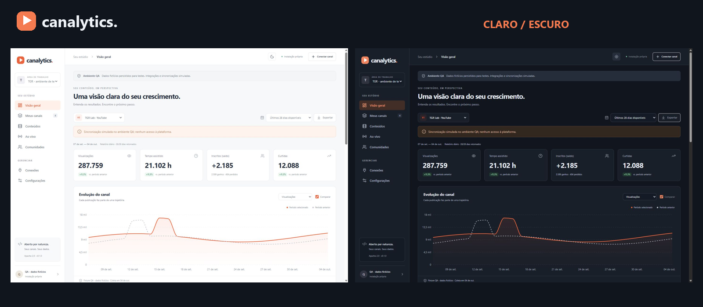

# Canalytics

**Seu conteúdo, em perspectiva.** Analytics open source para criadores, canais, transmissões e comunidades.

Canalytics segue a proposta do Observa: Apache-2.0, instalação própria, dados no seu servidor e conectores configurados pela interface. A versão 0.1.0 é uma prévia funcional, com backend real e demonstração separada dos dados de contas conectadas.

[Repositório](https://github.com/ThiagoRochaDev/canalytics) · [Versão e material de demonstração](https://github.com/ThiagoRochaDev/canalytics/releases/tag/v0.1.0) · [Verificações](https://github.com/ThiagoRochaDev/canalytics/actions)

## O que esta versão entrega

- Painel por canal com histórico, comparação de períodos, views, tempo assistido, inscritos, interações e exportação CSV.
- Catálogo pesquisável de conteúdos com contadores acumulados e consulta de retenção por vídeo do YouTube.
- Fontes de tráfego, dispositivos e países quando retornados pelo YouTube.
- Conexão de várias contas e canais, áreas de trabalho, OAuth e sincronização persistente.
- Credenciais criptografadas no servidor, sessões HttpOnly, controle de acesso por área e anotações.
- Temas claro, escuro e sistema, com preferência salva no navegador e layout para celular.
- Demonstração explícita com dados fictícios das marcas TGR, sem exigir autorização externa.
- Docker, execução local em Windows/Linux/macOS, testes e documentação para contribuidores.

| Conector | Implementação | Métricas |
| --- | --- | --- |
| YouTube | Implementado; validação real pendente | Relatórios diários, catálogo, público, retenção e receita com permissão adicional |
| Twitch | Implementado; validação real pendente | Estado da transmissão, seguidores, espectadores observados e VODs |
| Discord | Experimental | Membros aproximados, presença e canais do servidor |
| TikTok | Experimental | Perfil, seguidores, catálogo e contadores de vídeos |
| Bilibili | Planejado | Acesso à plataforma aberta ainda precisa ser validado |

**Implementado não significa homologado pela plataforma.** Os adaptadores têm testes com respostas simuladas; nenhum fluxo com conta de produção foi validado nesta entrega. É necessário cadastrar o aplicativo e obter os escopos/aprovações do provedor. Depois de configurar as credenciais, conectar contas é um fluxo pela interface.

## Interface e demonstração

Screenshots com dados fictícios. Veja [prints, vídeos e matriz de testes](docs/MIDIA-E-TESTES.md). Os vídeos e PDFs também estão disponíveis na [release v0.1.0](https://github.com/ThiagoRochaDev/canalytics/releases/tag/v0.1.0); não incluem contas reais.

## Começar com Docker

    git clone https://github.com/ThiagoRochaDev/canalytics.git
    cd canalytics
    docker compose up --build -d

Abra **http://localhost:8093**. Explore a demonstração ou clique em **Criar meu estúdio**. A primeira conta será a administradora; depois disso o cadastro público fica fechado.

O volume canalytics-data guarda o banco e a chave de criptografia. Faça backup dos dois juntos. O serviço é publicado apenas no loopback do host. Para acesso remoto, use proxy HTTPS e configure CANALYTICS_PUBLIC_URL no .env antes de iniciar.

## Executar sem Docker

Requisitos: Python 3.11+ e Node.js 22.6+. O Node constrói a interface; o Python serve o frontend compilado.

**Windows / PowerShell**

    .\scripts\start.ps1 -Install

O comando python deve apontar para uma instalação compatível. Depois da primeira instalação, use .\scripts\start.ps1.

**Linux / macOS**

    sh scripts/start.sh

Em ambos os casos, abra http://localhost:8093. Ctrl+C encerra o servidor. As credenciais das plataformas são configuradas em **Conexões**, nunca em arquivos públicos.

## Conectar plataformas

1. Crie um aplicativo no portal de desenvolvedores do provedor.
2. Copie a URL de callback mostrada em **Conexões → Configurar conexão**.
3. Cadastre Client ID/Key e Client Secret. Discord também requer o token do bot.
4. Clique em **Autorizar na plataforma**, escolha a conta/canal e conceda os escopos.
5. A primeira coleta entra na fila; a tela acompanha seu estado.

Para mais de um canal do YouTube, repita a autorização escolhendo o canal/Brand Account correspondente. A autenticação do Google não garante acesso automático a todos os canais que aparecem no Studio.

Use **Reautorizar** na conexão existente quando a autorização expirar, escolhendo o mesmo canal para preservar seu histórico. Remover uma conexão apaga seus dados locais e anotações após confirmação; a revogação na origem é feita nas configurações da plataforma.

Veja [configuração dos provedores](docs/INSTALACAO.md).

## Como interpretar os dados

- Relatórios diários e snapshots são categorias distintas. Contagens acumuladas não são convertidas em “views do dia”.
- Ausência de dados aparece como indisponível. Comparações percentuais exigem dois intervalos completos e base diferente de zero.
- O painel trabalha com um canal por vez. Não soma audiência única nem promete equivalência entre plataformas.
- As tabelas mostram valores acumulados desde a publicação. O filtro do gráfico não transforma esses valores em métricas do período.
- Detalhamentos de público exibem o intervalo de 180 dias da coleta; não mudam com o filtro do gráfico.
- YouTube consulta inicialmente 180 dias, até três dias antes da data atual, e conserva o histórico coletado. Dados recentes podem chegar com atraso.
- Catálogos limitados a 500 vídeos YouTube, 100 VODs Twitch e 200 vídeos TikTok. A interface informa avisos de cobertura.
- Twitch/Discord/TikTok constroem histórico a partir das coletas. Não há reconstrução de snapshots anteriores à conexão.
- Receita é indisponível sem o escopo e a elegibilidade necessários; valores do YouTube são estimativas em USD.

## Desenvolvimento e testes

Backend, com o ambiente virtual ativado:

    pip install -r apps/api/requirements.lock
    python -m uvicorn canalytics.main:app --app-dir apps/api --host 127.0.0.1 --port 8093 --reload --no-access-log

Frontend, em outro terminal:

    npm --prefix apps/web ci
    npm --prefix apps/web run dev

Abra http://localhost:5178. Use **localhost** no navegador e no callback para que a sessão iniciadora seja a mesma. O Vite encaminha /api ao backend.

    python -m pytest -q
    node --experimental-strip-types --test apps/web/src/analytics.test.ts
    npm --prefix apps/web run build

Os testes usam bancos temporários e respostas simuladas; não fazem chamadas às contas dos criadores. O workflow de CI também constrói e verifica o container.

## Escopo e evolução

O produto pode ser oferecido como instalação gerenciada, mantendo o código aberto. Esta prévia usa um administrador por instalação e múltiplas áreas, sem convites, cobrança ou recuperação de senha por e-mail. A organização por áreas não constitui um SaaS público pronto.

O próximo ciclo inclui testes reais de OAuth, revisão das exigências de retenção/revogação das plataformas antes de disponibilização pública, equipes, relatórios configuráveis, maior cobertura histórica e YouTube Reporting API. Publicação, agendamento, moderação, análise preditiva e marketplace de conectores permanecem no roadmap.

- [Arquitetura](docs/ARQUITETURA.md)
- [Status da implementação](docs/IMPLEMENTACAO.md)
- [Visão do produto](docs/PLANEJAMENTO.md)
- [Plano dos conectores](docs/CONECTORES.md)
- [Contribuição](CONTRIBUTING.md)
- [Segurança](SECURITY.md)

## Licença

Apache License 2.0. Consulte [LICENSE](LICENSE) e [NOTICE](NOTICE). Marcas e logotipos das plataformas pertencem aos respectivos titulares. Não há afiliação oficial implícita.
